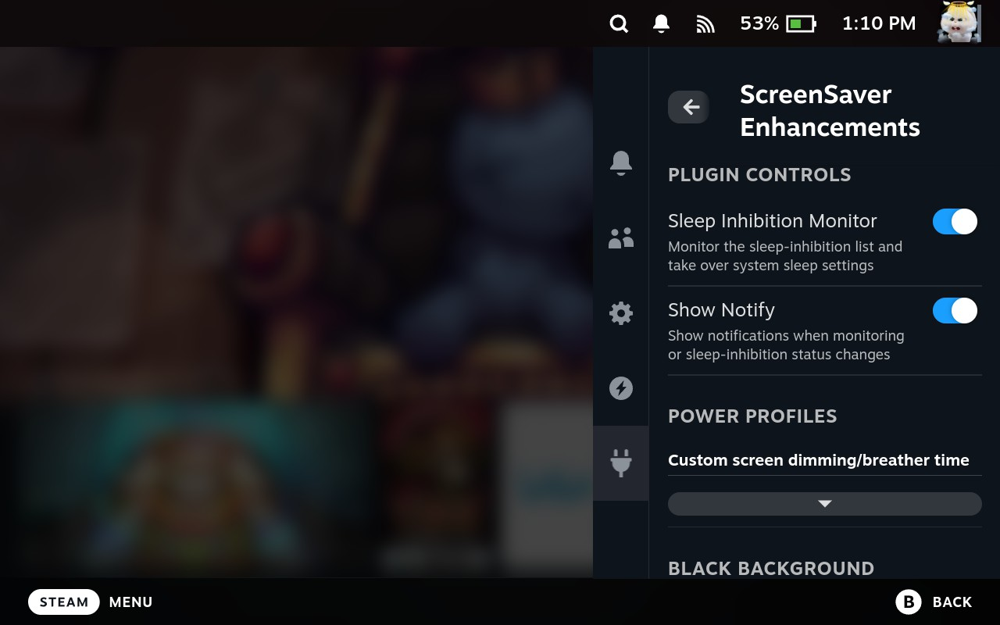
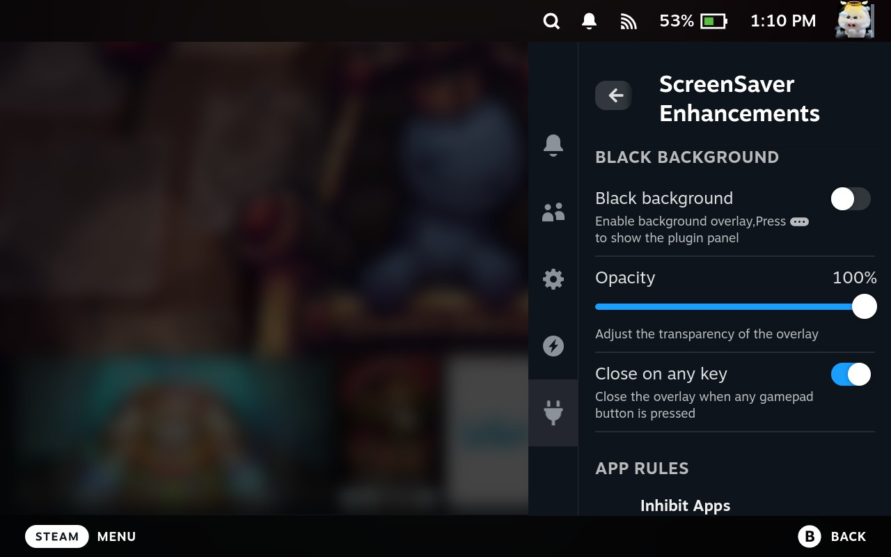
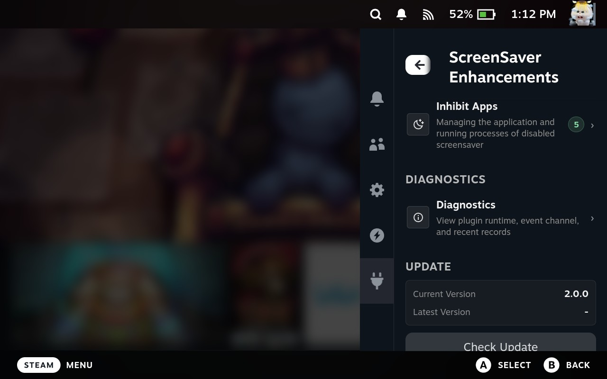
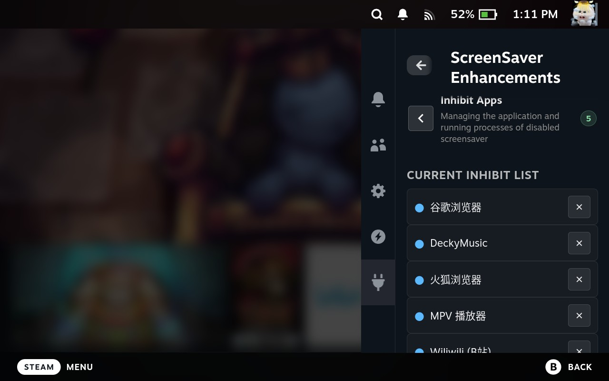
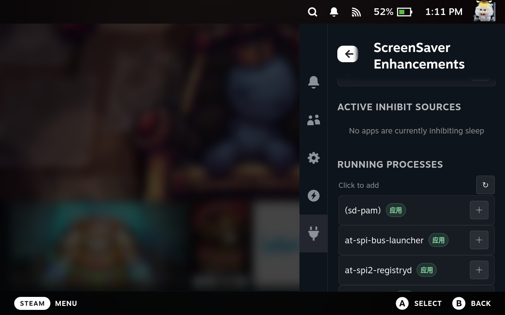
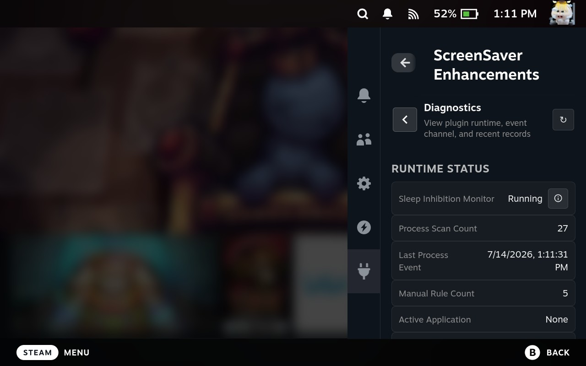
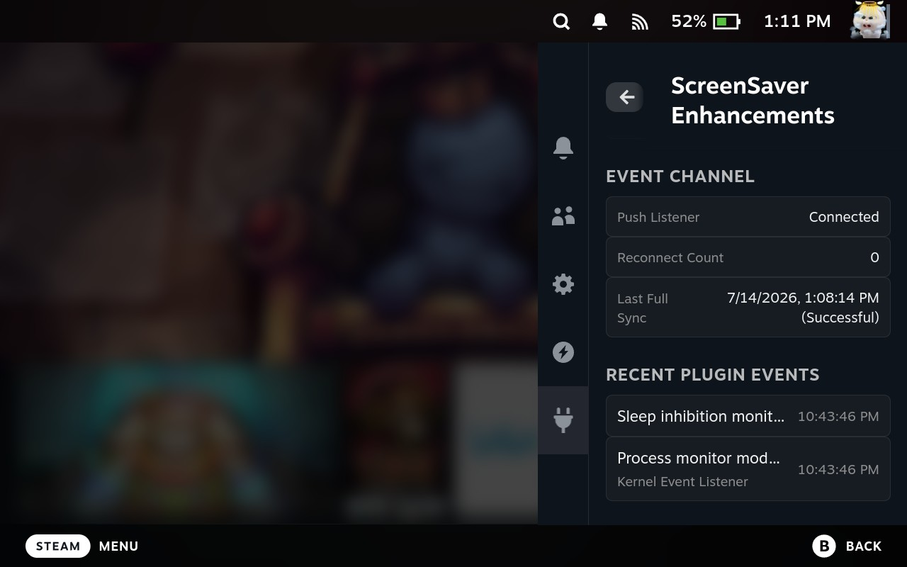
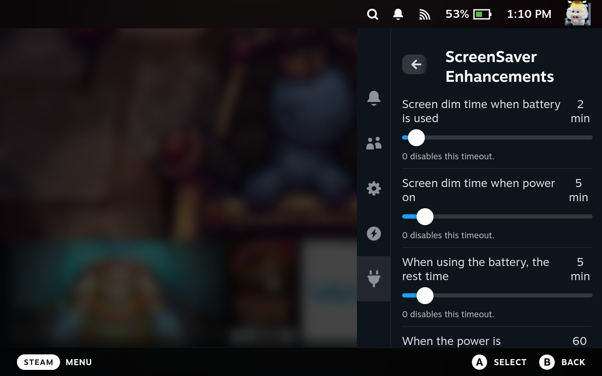

<div align="center">

# ScreenSaver Enhancements

[](https://github.com/Grails125/ScreenSaverEnhancements/releases/latest)
[](https://github.com/Grails125/ScreenSaverEnhancements/releases)
[](./LICENSE)

Keep your Steam Deck screen awake while media is playing or selected applications are running.

[中文说明](./README_ZH.md) | English

</div>

ScreenSaver Enhancements is a [Decky Loader](https://decky.xyz) plugin for Steam Deck. It handles standard D-Bus sleep-inhibition requests from supported media apps and can also monitor applications you choose yourself.

## D-Bus compatibility

If Steam or another desktop service owns a standard inhibit service name, the plugin keeps its other interfaces and manual process rules running without replacing that owner. Diagnostics separate monitor health, interface ownership and external observation. Unavailable names are retried individually without resetting other live requests.

A separate read-only connection observes successful external Inhibit/UnInhibit calls and records application, reason and cookie. Observation is always partial: requests predating the connection cannot be enumerated through the standard API, and disconnects or permission failures do not mean the system has no inhibitors.

Manual application rules are not a D-Bus allowlist. An application such as Edge can still issue its own playback-related inhibition request without being added to the manual list; the plugin records requests that it handles or successfully observes.

After the last known source ends, a 1.5-second stable window and a fresh status read precede actual power restoration. New sources cancel restoration; explicit monitor shutdown and unload restore promptly. Recovery notifications describe only the plugin restoring its saved power settings. Ordinary manual rules remain process-based, not playback-based.

Diagnostics show a compact overview with expandable D-Bus, Nested, technical and power sections; exported reports retain all fields. After an initial check, Nested discovery waits for Plasma process-start events without periodic scans when no session exists and the process subscription is confirmed. Existing sessions are checked every 5 seconds; failed queries retry after 2 seconds. When process events are unavailable, subscription confirmation times out, or event loss is detected, empty-session discovery falls back to every 10 seconds. Intervals exclude query time: playback transitions can take about 5 seconds to detect before the restoration window above. Manual rules and explicit monitor shutdown remain independent of these intervals.

## Features

- **D-Bus sleep inhibition** — supports standard inhibition requests from apps such as VLC, Chrome, mpv, and wiliwili. *(v1.0.0)*
- **Power settings recovery** — saves the current SteamOS screen-dim and suspend configuration before taking control, then restores it when inhibition ends or recovery is needed. Display-off sessions also restore the previous configuration on wake or exit; an independent guard wakes the display if the frontend loses contact. *(v1.0.0, strengthened in v2.0.4)*
- **Manual application rules** — choose running processes that should keep the screen awake, including Flatpak app IDs and full command lines. *(v1.0.0)*
- **DeckyMusic-aware playback detection** — detects actual audio playback from the backend only when a DeckyMusic rule is configured. It tolerates one short missed check before restoring normal sleep behavior, preventing false restores during track changes or brief stalls. *(v1.1.0, optimized in v2.0.0)*
- **Event-driven application monitoring** — listens for kernel process events when available and uses a 120-second fallback scan when necessary. DeckyMusic's 5-second audio check is independent, so it does not force repeated full process scans. *(v1.3.0, optimized in v2.0.0)*
- **Black display overlay** — optionally show a black overlay with adjustable opacity. *(v1.3.0)*
- **Display-off mode** — turn off the internal display while music, downloads, and other background applications keep running. Shares the overlay's Close on any key setting; when disabled, Quick Access wakes the display and opens the panel. The power button still suspends normally. Requires Steam's internal-display power API and reports failure when unavailable; waking may take a moment. *(v2.0.4)*
- **Separate battery and AC settings** — customize screen-dim and system-suspend timeouts for battery and external power, with two-way synchronization to the system settings. *(v2.0.0)*
- **V2 typed API and state synchronization** — uses Decky's modern typed RPC and push events for settings and inhibition state, with full-state reconciliation after a listener reconnect. *(v2.0.0)*
- **Diagnostics and updates** — inspect monitor mode, process activity, inhibition source, D-Bus requests, power override state, recent events, and event-channel health; copy the report or update from the plugin panel. *(v2.0.0)*
- **Reliable lifecycle handling** — cancels pending inhibition notifications during unload/restart, refreshes the panel when Decky reloads the plugin after an update, and prevents retired instances or delayed requests from overriding current settings and display state. *(v2.0.0, strengthened in v2.0.4)*
- **Decky Music MPRIS playback monitoring** — recognizes current Decky Music releases through their public MPRIS playback events while retaining the legacy DeckyMusic compatibility path. Playback changes no longer require a repeated full-process scan. *(v2.0.1)*
- **Nested Desktop playback monitoring** — automatically detects MPRIS playback on Nested Desktop session buses. Pausing, stopping, or exiting releases this playback inhibitor; configured manual rules remain unchanged. *(v2.0.4)*
- **Ukrainian localization** — supports Steam's Ukrainian language setting alongside English and Simplified Chinese. *(v2.0.4)*
- **Clearer diagnostics** — recent plugin events retain the latest 40 entries, can be cleared from the Diagnostics page, and now identify the application that added or removed a sleep rule or changed sleep-inhibition state. *(v2.0.1)*
- **Process-list refinements** — preserves Unicode process names, avoids duplicate localized labels, and improves the refresh feedback and scrolling behavior in the app-rules page. *(v2.0.1)*
- **Safer settings persistence** — validates setting values before saving, normalizes persisted values, and preserves malformed settings files for recovery instead of silently discarding them. Serializes setting changes and retains pending edits when the panel reopens. *(v2.0.2, strengthened in v2.0.4)*
- **Steam menu input compatibility** — supports current object-style `Unregister`/`unregister` handles alongside legacy function handles, and cleans up only valid handles without registering a null listener. *(v2.0.3)*

## What's new in v2.0.6

- Prevent plugin loading failures when Steam UI class discovery returns missing panel classes, as reported on some Steam beta versions.
- Validate class values, skip empty scoped CSS rules and preserve the localized title when its class map is unavailable. Existing class names and styles remain unchanged when available; missing panel classes fall back to the default layout.
- Add eight regression tests covering missing maps and fields, invalid values, whitespace, compound classes, CSS scope and title rendering.
- Keep application rules, power settings, D-Bus inhibition and Nested detection behavior unchanged.

See the [bilingual v2.0.6 release notes](./docs/releases/v2.0.6.md). This patch handles missing styling fields; it does not guarantee compatibility with every Steam beta build or repair unrelated Decky component-discovery failures.

## What's new in v2.0.5

- Keep monitoring and configured application rules running when Steam owns a standard D-Bus name, without taking that name away from Steam.
- Observe successful external requests independently and record application, reason and cookie, with explicit partial-observation limits.
- Delay actual power restoration by 1.5 seconds after all known sources end; revalidate state, cancel on new sources and retry failed restoration within a bounded budget.
- Group diagnostics into an overview and expandable D-Bus, Nested, technical and power details; preserve full diagnostic exports and three-language support.
- Stop periodic Nested discovery when no session exists and process events are confirmed. Check existing sessions every 5 seconds, retry failed queries after 2 seconds, and use 10-second empty-session discovery only when process events are unavailable.
- Detect rejected or silent process-event subscriptions and sequence gaps, and fall back safely instead of waiting forever.

See the [bilingual v2.0.5 release notes](./docs/releases/v2.0.5.md) for details, timing trade-offs and upgrade instructions. Existing application rules remain unchanged.

## What's new in v2.0.4

Thanks to [WowOne987](https://github.com/WowOne987) for contributing Nested Desktop MPRIS playback monitoring and Ukrainian localization in [PR #1](https://github.com/Grails125/ScreenSaverEnhancements/pull/1).

- Add Nested Desktop MPRIS playback detection and Ukrainian localization, preserving existing application rules and Chinese labels.
- Add internal display power control while retaining the black overlay and shared input-wake setting.
- Improve wake-request response and fix touch presses that scroll the action without activating it.
- Strengthen display and power-profile recovery, isolating timed-out requests and retired plugin instances.
- Refresh the panel when Decky reloads this plugin after an update, and prevent stale settings and query results from replacing newer state.
- Correct the installer identity to use the manifest name, fixing updates that extracted files but failed to reload the plugin. The original v2.0.4 package was withdrawn; this corrected release keeps version 2.0.4.
- Improve D-Bus reconnection, request ownership checks, and listener cleanup.
- Shorten UI descriptions, explain display wake delay, and clarify automatic suspend timeout labels.
- Update build dependencies to remove known vulnerabilities and verify all required backend modules are packaged.

## What's new in v2.0.3

- Supports current object-style `Unregister`/`unregister` handles while retaining compatibility with legacy function handles.
- Cleans up only valid listener handles and does not register a null listener, preventing Steam and Quick Access Menu short presses from failing after suspend and resume.

## What's new in v2.0.2

- Rejects invalid setting values and normalizes valid application rules before persistence.
- Restores invalid persisted public settings to safe defaults during startup.
- Preserves malformed settings files with a `.corrupt` suffix for troubleshooting and recovery.

## Screenshots

### Main panel

| Monitor and main controls | Mask switches and settings | App rules, diagnostics, and update entry points |
| --- | --- | --- |
|  |  |  |

### Application rules

| Configured inhibit list | Running-process selection |
| --- | --- |
|  |  |

### Diagnostics and power profiles

| Runtime diagnostics | Recent diagnostic events |
| --- | --- |
|  |  |

These diagnostics screenshots show the earlier layout. Since v2.0.5, detailed fields are grouped into expandable sections.



## Install

### Prerequisite

Install [Decky Loader](https://decky.xyz) first. If it is not installed, run the official installer on the Steam Deck:

```sh
curl -L https://github.com/SteamDeckHomebrew/decky-installer/releases/latest/download/install_release.sh | sh
```

### Release package

1. Download `ScreenSaverEnhancements-v<version>.zip` from the [latest release](https://github.com/Grails125/ScreenSaverEnhancements/releases/latest), for example `ScreenSaverEnhancements-v2.0.6.zip`.
2. Open **Decky Settings** → **Developer** → **Install Plugin from ZIP**.
3. Select the downloaded ZIP package and complete the installation.

Earlier releases may use the filename `ScreenSaverEnhancements.zip`.

### Build from source

```powershell
npm.cmd install
npm.cmd test
python build.py
```

The package is created at `build/ScreenSaverEnhancements-v<version>.zip`, using the project version (for example `build/ScreenSaverEnhancements-v2.0.6.zip`). Install it using the release-package steps above.

## Upgrade

The plugin can check for updates from the bottom of its panel. When a newer release is available, open the update section, review the version and release notes, then start the upgrade there.

If an older version's built-in update stalls, including the original v2.0.4 package with the installer-identity issue, install `ScreenSaverEnhancements-v2.0.6.zip` through **Decky Settings** → **Developer** → **Install Plugin from ZIP**. Publishing a newer release cannot repair the updater already running in an older installation. Both versioned and fixed-name compatibility ZIPs contain the same plugin.

Decky automatically reloads this plugin after installation; restarting the whole Decky Loader is unnecessary.

To upgrade manually, download the latest release package, then select it through **Decky Settings** → **Developer** → **Install Plugin from ZIP**.

## Uninstall

1. Open **Decky Settings** → **Plugins**.
2. Find **ScreenSaver Enhancements** and select **Uninstall**.
3. Confirm the uninstall when prompted.

## How it works

The plugin uses three complementary sources of inhibition:

- **D-Bus mode** registers standard sleep-inhibition services. When an application calls `Inhibit`, the backend pushes a state update and the frontend applies the configured SteamOS power behavior.
- **Manual mode** watches the configured process rules. It prefers process events and automatically switches to low-frequency scanning when the event source is unavailable.
- **Nested Desktop MPRIS** watches players on separate Nested Desktop session buses. Only active playback adds an inhibitor; a brief query failure retains the last confirmed playback state for a bounded grace period. Existing manual rules still apply independently, so a configured browser rule can keep inhibiting after media pauses.

DeckyMusic is a specialized manual rule: its audio state is checked every five seconds only while the rule is configured. Normal manual application rules remain event-driven, with a 120-second fallback scan, so the two paths do not multiply process-scanning work.

All sources share the same state synchronization and power-control path. Before overriding power behavior, the plugin records the current settings; once every known plugin source ends and the stable window is confirmed, it restores that saved configuration instead of writing fixed defaults. This does not claim that every external system inhibitor has ended.

## Development

| Command | Description |
| --- | --- |
| `npm.cmd install` | Install frontend dependencies. |
| `npm.cmd test` | Run TypeScript validation and discovered JavaScript and Python tests. |
| `npm.cmd run build` | Build the frontend bundle. |
| `python build.py` | Build the installable plugin directory and ZIP package. |

## Credits

- [xfangfang/DeckyInhibitScreenSaver](https://github.com/xfangfang/DeckyInhibitScreenSaver) — the project this plugin extends.
- [WowOne987](https://github.com/WowOne987) — contributed Nested Desktop MPRIS playback monitoring and Ukrainian localization through [PR #1](https://github.com/Grails125/ScreenSaverEnhancements/pull/1).
- [Decky Loader](https://github.com/SteamDeckHomebrew/decky-loader) — Steam Deck plugin loader and platform.

## License

This project is licensed under the [BSD 3-Clause License](./LICENSE).
